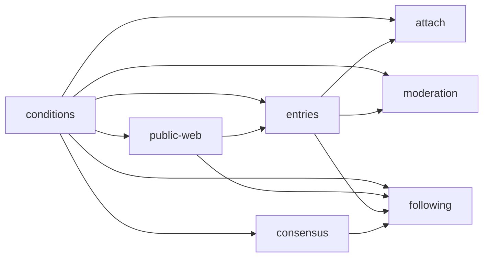

# Design: 249 feed sub-modules

## Problem

`feed` is the largest module: 96 files, fan-out 10, all in one folder
(#796). This lane moves it into the seven sub-modules design 240 §"The
tree" › `feed` lists. Paths and imports change; behaviour does not.

## Approach

The target is design 240's table, unchanged. 86 of 96 files move; each
sub-module gets an `index.ts` (its door) and a `components/` folder.

Checked against today's imports (every file placed, service imports
only, between units):

Read an arrow as "is imported by". There is no cycle, so `no-circular`
holds at the doors.

- **Doors.** A door exports only the names that another unit's service
  code (parent `index.ts` and `functions.ts` included) and `src/server.ts`
  import today. Widest is `entries` (31 names), then `conditions` (21);
  all are under the 45-name budget, so no door needs a pin.
- **Service imports between sub-modules go through the door.**
  `functions.ts` and `index.ts` import doors too. `feed/index.ts` keeps
  its names, re-exported from the doors (rule 4).
- **Components import files, never a door** (rule 5), including when they
  import another sub-module's component or helper.
- **Three in-module knots, where a parent helper reaches into a
  sub-module** (rule 2's rule does not match parent files):
  - `redirect.ts` → `profiles` and `attach-rules.ts` → `attach-context`
    are type-only. They become `import type` from the door.
  - `kit-push.ts` imports `uiGroups` by value from `groups.ts`, which
    the tree puts in `conditions`. See the delta below: `groups.ts` stays
    beside the parent's `index.ts`, so this import is unchanged.
  - `route-decisions.ts` imports a component's helper (`handleText`):
    unchanged, components are imported by file.
- **`src/server.ts`**: `./modules/feed/moderation` now resolves to the
  `moderation` door, which exports `sweepCopyrightHolds`. The path text
  may not change at all; "past the door" for `feed` goes 1 → 0.
- **Pins**: `npm run modules:pin` lowers `feed`'s. Expected: `files` and
  `pastDoor` leave the file. Fan-out stays 10, because the moves do not
  remove an import from another module.
- **Shared files**: architecture tests that name feed paths
  (`primitive-restrictions`, `targets-and-focus`, `one-h1-per-route`,
  `system-account`, `run-conditions-writers`, `weather-tables`,
  `daily-upkeep`, `test/ops/public-cache`), the tests under `test/`
  that import feed files, `docs/contracts.md` §Component convention (if
  no move PR has rewritten it yet), and the regenerated
  `structure.generated.c4`. No `stryker.conf.json` edit (feed is a `**`
  glob).

## Contract touches

- Schema changes needed: **none**
- New route files: **none**. Routes under `src/routes/` that import feed
  files get new paths.
- New bindings/queues/crons: **none**
- Forbidden-zone edits, **granted by the owner on 2026-11-19** (#796
  comment), path prefixes only: `guardrails.config.json`'s 32 keys on
  feed files, and `eslint.config.js` `primitiveExemptions`' three feed
  component paths. Without them the moved files fail `sanctions-check`
  and lint.
- Screens: none change. No demo video.

## Test plan

- No new tests: a move adds no behaviour. Every existing test that
  imports a feed file follows it; full `npm test`, lint, typecheck,
  `npm run build` and `npm run e2e:ci` before shipping.
- `test/architecture/module-shape.node.test.ts` with the lowered pins.
- Mutation: the push gate does not mutate renamed files (it lists them
  with `--diff-filter=ACM`). CI's two `feed` Mutation shards (`.ts`, and
  the `.tsx` shard that `feed` shares) run cold once: two to three hours.

## Issues

- Refs #796 (stays open for step E).
- Opens: none expected. Anything found along the way becomes an issue,
  not a commit.

## Delta from design 240's tree

**`groups.ts` and `judged-conditions.ts` stay beside `feed/index.ts`,
not in `conditions`.** Both are pure, with no data and no `env`, and five
sub-modules use them. Client-side files import them by value: `bar-share.ts`
and `coverage.ts`, which components import, and `kit-push.ts`, which
routes import. Through the `conditions` door, those imports pulled
`conditions.ts`, then `weather`, then `env` into the client. Six `ui`
tests failed to load on `cloudflare:workers`, the same failure a client
bundle would hit. Rule 5 already places "the few pieces with no data of
their own that several sub-modules' screens use" in the parent. 240's
simulation counted only service imports, so it could not see this. The
other sub-modules' doors have no client-reachable importer (checked
from every component and route).

## Open questions

None.
