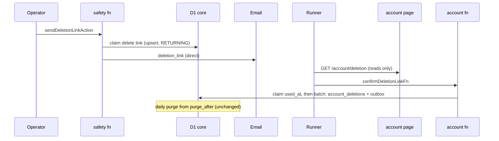

# Design: 289 the deletion link for closed accounts

> #1179, Design Round 64 items 372–374
> ([`docs/design-deltas/round-64.md`](../design-deltas/round-64.md), board
> [`design/Round 64 Rulings.dc.html`](../../design/Round%2064%20Rulings.dc.html),
> both on `main` since #1181). The words below are the
> owner-approved ones (2026-11-27), quoted as written; `{…}` marks what the
> build computes (a date, a handle, a masked address). Over the template's
> page: the schema and the file list are the deliverable. The coordinator
> approved the schema, and the owner ruled on every open question
> (2026-11-27, §Rulings).

## Problem

A closed account can't sign in, so it can't reach Settings › Account to
delete itself. Round 64 gives it a way: the Desk emails a single-use link
to the account's own address, and following it schedules the purge, with
no sign-in. An "Under 18" closure schedules the deletion itself, with no
link, because that account must not stay.

## Approach

**Premise check.** Nearly everything exists. `email_verifications`
(`account/verification/email-links.ts`) already holds single-use,
expiring, replaceable email links: 32 random bytes, only their SHA-256
stored, one row per runner and purpose, spent by a claim on `used_at`
(law 2) and released if the work fails. `account_deletions` is already the
purge's claim, and the purge already purges a closed account. The ban
gate already refuses every new session, so the leaving gate is never
reached. The work is a third link
purpose, the Desk's action, a public page, and one fact the schema lacks:
who scheduled a deletion.

**The token.** Purpose `delete`, made by `emailLinkWrite` as the confirm
links are: `delete.{userId}.{secret}`, the secret's hash stored. The link
lifetime becomes per purpose (24 h for `verify` and `change`, as now;
`DELETION_LINK_TTL_S`, 7 days, for `delete`, in `lib/contracts` beside
`DELETION_GRACE_S`). The owner said "signed": this is a random secret
proved against its stored hash, not an HMAC. It needs no new secret
binding, and unlike a stateless signature it can be withdrawn (Reopen) and
spent only once.

- **Forgery and guessing:** a 256-bit secret; a token is checked only
  against its own account's row.
- **Replay:** the spend is one conditional `UPDATE` on `used_at`; a second
  press, or a second tab, reads "already used".
- **Enumeration:** a bad shape, an unknown account, an expired, replaced or
  withdrawn link all read as the same LINK EXPIRED state. The handle and
  the date show only to a token whose secret matches.
- **Purpose confusion:** `readEmailLink` takes the purposes its landing
  accepts. `/account/verify` reads only `verify` and `change`, and the new
  page only `delete`, so each landing spends only its own links.
- **Prefetch:** opening the link (GET) reads and writes nothing. Only the
  button (POST) spends it.
- The live link is sent straight away and never written to the outbox, as
  the confirm links are. It is never in a Sentry context (law 7).

**The Desk action (372).** `sendDeletionLink` (`account/data/deletion-link.ts`):
on the primary, the account must be closed, with no deletion scheduled and
no unspent link that has not expired. The claim is the upsert on
`(user_id, purpose)`, updating only an expired, unspent row, `RETURNING`.
A double press sends once (law 8b by the unique row). The address is the
account's own `user.email`, read at send. The email goes straight after the
write. If the send fails, the row is deleted (only this claim's hash) and
the panel shows NOT SENT, so the operator can press again (law 8c).

**The email (374.1)**, new kind `deletion_link` {url, handle?, until},
reply-to the Desk inbox: subject "Delete your closed dialed.run account",
kicker DELETE, "Your account @{handle} is closed. If you want it deleted
too, use this link. Your runs, closet, entries and photos go 7 days after
you confirm.", one ink link "Delete my account", then "The link works
once, until {expiry day}. If you'd rather keep the account closed, ignore
this email and nothing happens."

**The page (374.3)**, `src/routes/account/deletion.tsx`, at
`/account/deletion?token=`. It is the link landings' ask
(`LinkLanding`'s panels: no bars, MEASURE.panel, one ink button, pending
brackets), with its loader on `readDeletionLinkFn` and its button on
`confirmDeletionLinkFn`. The states:

| state            | when                                          | words                                                                                                                                                                |
| ---------------- | --------------------------------------------- | -------------------------------------------------------------------------------------------------------------------------------------------------------------------- |
| ask              | live, unspent, still closed                   | "Delete your account?" / "@{handle} is closed. Deleting it removes your runs, closet, entries and photos on {now + 7 d}. You can't undo this." / "Delete my account" |
| done             | this press spent it                           | DELETION SCHEDULED, "Your account goes on {day}." / "We've sent an email saying so. There's nothing more to do."                                                     |
| expired, unknown | no matching row, expired, or no longer closed | LINK EXPIRED, "This link doesn't work any more." / "To ask for a new one, reply to the email it came in."                                                            |
| already used     | spent, deletion pending                       | DELETION SCHEDULED, "This account already goes on {day}." / "The link was used. There's nothing more to do."                                                         |
| failure          | the press failed                              | NOT DELETED, "That didn't go through."                                                                                                                               |

**Scheduling the purge.** `confirmDeletionLink`, on the primary: the
standing is read again, then the link is claimed (`didClaimEmailLink`).
Then one batch writes the `account_deletions` row (`purge_after` = now +
`DELETION_GRACE_S`, `cause` `asked`), only while the account is still
closed (`EXISTS` on `banned_at`), and owes the delete-scheduled email
(374.4) through the outbox. If the batch fails, the claim is released
(`spendClaimed`'s pattern). Strava is disconnected afterwards, as a
runner's own request does (law 5, reported on failure). The purge itself
is untouched: from `purge_after` it claims the row like any other.

**374.4.** `deletion_scheduled` gains an optional `closed: true` (law 9: an
older build ignores it). For a closed account, the foot "Didn't ask? Log in
and keep it, then change your password." becomes "If this wasn't you,
reply to this email before {day}." The Keep button goes too (ruling 3).

**The under-18 closure (373, 374.2).** `closureRules` gains `under_18`,
"Under 18", between the rules and Suspected CSAM, with a hairline on each
side (`PickOne`'s `hairlineBefore` takes a list). While it is picked, the
line above the submit reads "Closing for age also deletes the account on
{now + 7 d}. No link is sent.", and it stays if the submit fails.
`banUserAction` hands `banUser` the age writes through `also`: the
`account_deletions` row with `cause` `under_18` (insert-or-ignore: a
runner's own earlier request keeps its date and cause), and the age email
in place of `account_closed`. That email is the new kind
`account_closed_age` {handle?, day}, reply-to the Desk inbox: "Your
dialed.run account is closed", kicker ACCOUNT CLOSED, "We closed @{handle}
because dialed.run is for runners 18 and over. Your runs, closet, entries
and photos will be deleted on {day}.", no link, then "If we got your age
wrong, reply to this email before then." It names no rule.

**Reopen.** `unbanUser`'s batch gains account's `reopenDeletionWrites`,
ahead of the lift and folded on "still banned". They delete an unstarted
`under_18` deletion ("Reopening before then also cancels the deletion.")
and withdraw any delete link ("Reopening cancels it."). A deletion the
runner chose (`asked`) blocks the lift (ruling 4), and so does a
purge that has started.

**The Desk panel.** `DeskRunner` gains `bannedAt`, `maskedEmail` (email's
`maskedAddress`, server side) and `deletion` {requestedAt, purgeAfter,
cause} in place of `isLeaving`. It also gains `deletionLink` {expiresAt,
isUsed}, read by account's `deletionLinksOf` and handed in by the server
function, as `listAccounts` is. A pure `closedPanelOf` picks the state.
The panel moves to a new `ClosedAccountPanel.tsx` (DeskRunners.tsx is 805
lines). Both pills are QUIET_PILL ("the same kind; neither is the panel's
primary"). The states:

- **offer:** Reopen and "Send deletion link". The ask replaces the pills in
  place: "Send a deletion link to {masked address}? It works once, until
  {now + 7 d}. Nothing is deleted unless they use it.", with Send link
  (CHALK_PILL) and Cancel. Cancel returns focus to the pill, and a failed
  send shows NOT SENT on the row.
- **sent:** `[SENT {day}]`, "The link works until {expiry}. Reopening
  cancels it.", and Reopen only. The sent day is `expires_at` less the TTL.
- **deleting:** `[DELETES {day}]`, "The runner confirmed on
  {requested_at}.", no pills, and the row gains `[PENDING DELETE]`.
- **expired:** `[LINK EXPIRED {day}]`, Reopen and "Send again" (the same
  ask, with a new date).
- **age:** "Under 18 · closed {date}", `[CLOSED] [PENDING DELETE]`,
  `[DELETES {date}]`, "Reopening before then also cancels the deletion.",
  and Reopen only.

## Schema (approved by the coordinator, 2026-11-27)

**Migration `0002_add_account_deletion_cause` (core):**
`ALTER TABLE account_deletions ADD cause text DEFAULT 'asked' NOT NULL`.
It is drizzle `text("cause", { enum: ["asked", "under_18"] })`, with no
CHECK. Additive. There is no new index: every read is by `user_id`, the
primary key.

- **Why:** three things turn on who scheduled the deletion. Reopen
  cancels an age deletion and must never cancel one the runner chose. The
  panel says "Under 18 · closed …" and keeps Reopen, or "The runner
  confirmed …" with no pills. A link may not be sent for an age closure.
  Nothing stored says it today: `ban_reason` and `moderation_actions.reason`
  are the operator's free words, and the closure's rule is not kept at all.
- **Rejected, no migration:** reading "age" off `requested_at =
banned_at` (the age closure writes both in one batch). It holds only by
  coincidence, and a runner's own request in the closing second would read
  as age, so Reopen would cancel it. A ban is one fact (`bans.ts`). This
  one should be too.
- **Rejected:** a `user_profiles.ban_rule` column. It would also give the
  board's "{rule} · closed …" line for every closure (ruling 6), but
  it can't tell a runner's own earlier request from an age deletion.

**No migration, still in `schema-core.ts`:** `email_verifications.purpose`'s
TypeScript enum gains `delete`. The column has no CHECK, so this changes no
SQL, and the existing unique `(user_id, purpose)` index serves every read.
No existing table could hold the link better than this one: it is
already the single-use, replaceable link store, purged with the account.

## Contract touches

- Schema: above. No new bindings, queues or crons.
- Routes: new `src/routes/account/deletion.tsx`. The change to
  `src/routes/desk/runners.tsx` wires the new action.
- Email kinds (`lib/contracts/email-kinds.ts`, `email.ts`): `deletion_link`
  and `account_closed_age` are new; `deletion_scheduled` gains
  `closed?: true`. `email/deliver.ts`' `REPLY_TO` adds the two new kinds.
- `safety/rules/contracts.ts`: `closureRules` and labels; `closureRuleOf`
  names no rule for `under_18`.
- Files: `db/schema-core.ts`; `db/migrations/core/0002_*` and meta;
  `lib/contracts/{garments,email-kinds,email}.ts`;
  `account/verification/{email-links,verification,index}.ts`;
  `account/data/{deletion-link.ts (new),index.ts}`;
  `account/data/components/DeletionLinkLanding.tsx` (new, on
  `LinkLanding`'s panels); `account/{functions,inputs}.ts`;
  `email/{content,deliver}.ts`;
  `safety/{functions,inputs}.ts`; `safety/runners/{bans,runners}.ts`;
  `safety/runners/components/{DeskRunners,ClosedAccountPanel (new)}.tsx`;
  `ui/{form,DeskForm}.tsx` (the hairline list); `docs/architecture.md`
  (§Account deletion). It touches nothing under `account/purge/` or
  safety's takedowns or quarantine.
- **Server functions:** `sendDeletionLinkAction` (safety, POST) is
  **admin**: `requireAdmin(await verifiedUserId())`, as Reopen is.
  `readDeletionLinkFn` (account, GET) and `confirmDeletionLinkFn`
  (account, POST) are **sessionless**: the token is the authority, as for
  `readEmailLinkFn` and `confirmEmailFn`. `banUserAction` and
  `unbanUserAction` stay admin. That is three new rows in
  `verification-class.test.ts`.
- **Door budgets:** `safety/index.ts` (95, pinned) gains nothing:
  `functions.ts` imports its own files. `account/index.ts` (35, pinned)
  gains nothing: safety's `functions.ts` reaches the `account/data` door
  (about 11 names after this) and account's `functions.ts` its own
  files. `account/verification`'s door gains the four link primitives
  (about 21 names). Both stay under 45. Fan-out doesn't change.
- **Diagrams:** `flows/deletion.c4` gains `deletionLinkStory` ("A closed
  account is deleted through a link the Desk sends") and the age closure
  as its own view. `model.c4` gains `cf.app.safety.sendDeletionLink` and
  `cf.app.account.deletionLink`, then `npm run diagrams:generate`.

## Test plan

- worker `test/email/verification.test.ts`: a `delete` link lives 7 days
  and the others 24 h; `/account/verify` refuses a `delete` token, and the
  new page refuses the other purposes.
- worker `test/account/deletion-link.test.ts`: a send only reaches a
  closed account with no deletion, at its own address; a second send
  while a link is live sends nothing, and one after expiry replaces it; a
  failed send withdraws the row; no outbox row holds the link. The read
  writes nothing and returns each state. The confirm schedules now + 7 d
  and owes the closed delete-scheduled email in its batch; of two racing
  presses, one schedules and one reads used; a Reopen in between leaves
  nothing scheduled; a failed batch releases the claim.
- worker `test/safety/bans.test.ts`: an under-18 closure writes
  `cause = under_18` and owes the age email, not `account_closed`. Reopen
  cancels it and withdraws a link, but cancels nothing the runner chose,
  and lifts nothing once a purge has started.
- worker `test/safety/contracts.test.ts`: the order of `closureRules`.
  `test/email/render.test.ts`: the three emails' words and reply-to.
- worker: `closedPanelOf` for every state, including one exactly at
  expiry.
- dom `test/safety/desk-runners.dom.test.tsx`: each panel state, the ask
  and Cancel's focus, NOT SENT, the age line while Under 18 is picked and
  after a failed submit, and the hairlines.
  `test/account/deletion-link-page.dom.test.tsx`: the four states, and the
  failure band.
- journey: extend `e2e/safety/moderation.journey.spec.ts` (D8 already
  closes an account there): Send deletion link, the link read from the
  email (`e2e/support/email-links.ts`), the page signed out, Delete, done,
  and the Desk's `[DELETES …]`. Playwright, because a new route, a
  sessionless spend and the email hop cross the server. It also gives the
  page its a11y coverage. No conformance spec: link landings have none, and
  this page uses their panels.
- Demo (scratch, seeded): the same path, then an under-18 closure and its
  Reopen.

## Issues

- Closes: #1179.

## Rulings (2026-11-27)

The open questions this doc asked, as the coordinator and the owner
answered them. Each is built as ruled.

1. **Schema:** approved. Migration `0002` adds `account_deletions.cause`
   (`asked` by default); `email_verifications.purpose` gains `delete`.
   Additive, before the first deploy.
2. **A runner with no handle:** the fallback lines are approved: "Your
   account is closed." (the link email and the page's ask) and "We closed
   your account because…" (the age email).
3. **374.4:** the foot "Didn't ask? Log in and keep it, then change your
   password." becomes "If this wasn't you, reply to this email before
   {day}.", and the "Keep my account" button goes, for a closed account.
4. **Reopen once the runner chose deletion** is refused on the server and
   hidden on the panel, including a runner who asked before being closed.
5. **Dates:** the runner's emails and the link's page say the day in the
   runner's home zone (`deletionDay`, UTC when there is none). The Desk
   stays UTC.
6. **The closed panel** keeps the operator's reason as built; "Under 18 ·
   closed {date}" is for age closures only.
7. **Under 18:** the Why field stays required; reporters are told it was
   removed, as for any closure but suspected CSAM; Strava is disconnected
   when the link is used, not at an age closure.
8. **The legal texts:** another session drafts the terms and privacy
   policy line that ships with this PR. This PR writes none.
9. **The token:** the hashed random secret is approved, not an HMAC: the
   link is single use and withdrawn by Reopen through the existing
   `email_verifications` machinery.

## As built

- The email layout has no kicker slot, so the two new emails carry none,
  as no account email does (Design delta).
- Desk brackets date as the Desk's other mono dates do (`monthDayLabel`:
  "SENT NOV 27"), not the board's "27 NOV" (Design delta).
- Reopen is a QUIET_PILL beside "Send deletion link" (372: "the same
  kind; neither is the panel's primary"), where round 44 #104 made it
  the chalk pill; the ask's Cancel is `QUIET_CANCEL`, as the Desk's
  other asks.
- The link email and the age email reply to the Desk's inbox
  (`APPEAL_ADDRESS`); the closed variant of "delete scheduled" replies to
  the From address, as the runner's own does.
- The page reuses `LinkLanding`'s `AskPanel`, `LandingEnd` and
  `useConfirmLink`.
